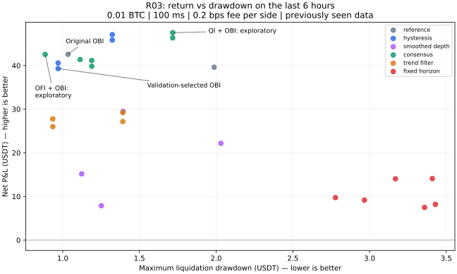

# R03：低回撤、稳定性与手续费后的收益筛选

完成日期：2026-11-03。**32个候选、792次逐事件仿真、2,376个费用场景。** 这是一轮有边界的回顾性探索，不是新的独立样本外验证。

## 结论

- **低费率候选：强OBI＋延迟退出 `hysteresis_0.7_30`。** 在前4小时训练、随后2小时选型后冻结，最后6小时复核：单边0.2bps、100ms，464笔，净收益39.311383 USDT，按1,000 USDT初始资金折算3.9311%，清算口径最大回撤0.969884 USDT，6/6小时盈利。
- **它不是全面击败原策略。** 同一6小时和费用下，原OBI净收益42.568212、回撤1.034811，836笔。新候选减少44.50%的交易、每笔净收益提升约66.39%、盈亏平衡费用从0.531提升至0.751bps；总利润低7.65%，回撤低6.27%。这更接近“降低周转、提高每笔质量”。
- **零手续费候选仍是原QI。** 不是复杂模型：复核6小时净收益74.141266 USDT，回撤0.924600，6/6小时盈利；500ms仍为62.308553。
- **主筛选情景单边1bps没有合格策略，选择空仓。** 26个产生交易的候选在最后6小时、100ms下均为负收益；6个预测收益模型未交易。没有把未交易模型称为赚钱算法。
- 测试后看到的更高收益版本仅列作下一轮候选，不替换事先选中的版本。低费候选和零费候选均通过本轮预设复核门槛，但仍需新的独立日期。

## 数据、切分和公平比较

沿用R02 SHA256审计后的12个完整小时。首小时因接收超时后缺新快照，被R02按数据质量规则统一隔离；本轮没有按收益挑小时，也没有恢复无效数据。

| 用途 | 北京时间起止（各小时之间有采集间隔） | 小时 |
|---|---|---:|
| 训练 | 11-02 20:36:33 — 11-03 00:36:41 | 4 |
| 选型 | 11-03 00:36:43 — 11-03 02:36:46 | 2 |
| 复核 | 11-03 02:36:49 — 11-03 08:37:04 | 6 |

R02已经查看过全部12小时，因此这里的“复核段”**不是全新未见数据**。4/2/6切分只防止程序直接使用后段标签训练和选型，不能消除研究者已看过整体结果带来的选择偏差。训练模型不跨小时生成未来标签，标准化仅拟合前4小时；选型文件在运行后6小时前写入。

统一账户假设：初始1,000 USDT、每次固定0.01 BTC、不加杠杆、不复利；所有版本保持相同数量，并检查买入现金足够。资金数值是归一化比较口径，不是用户实际账户资金或建议投入。不能把本次收益率线性年化，不能把同仓位解释为同风险。

成交假设：Binance BTCUSDT现货做多/空仓，逐事件重建盘口，吃单逐档VWAP；信号后第一个满足100ms/500ms延迟的事件成交。每小时独立开平仓，分段间不持仓。价差和当前可见深度已进入成交价；费用逐边收取。接收时间是信息可用时间的代理，延迟不是实测下单回执。没有模拟自身市场冲击、抢跑或实际成交失败。

回撤改用每个事件上“立即按可见买盘平仓、扣除双边成本”的净值，相比上一轮中间价标记更保守。图表可以按秒采样，但报告中的回撤用全部事件计算。

## 固定的筛选规则

每种已声明费用0 / 0.2 / 1bps分别选择，主情景为1bps。要求两个验证小时在100ms、500ms下都盈利，每种延迟至少20笔；在合格候选中最大化 `min(两种延迟的净利润 − 0.5×清算最大回撤)`。无正分合格候选则选择空仓。

最后6小时只复核已选版本：至少30笔、至少5/6小时盈利、剔除最大3笔后仍盈利、两种延迟净利润均正，且回撤不超过净利润的一半。该门槛不是统计显著性证明，也不控制32个候选的多重检验误差。

## 同一复核段的核心比较

下表均为最后6小时、100ms，金额USDT。每边0.2bps = 每边0.002%；费用是假设，未核实任何账户实际费率。

| 版本 | 单边费用bps | 笔数 | 净收益 | 账户收益率 | 最大回撤 | 盈利小时 |
|---|---:|---:|---:|---:|---:|---:|
| 零费预选：QI | 0 | 1122 | 74.14 | 7.41% | 0.9246 | 6/6 |
| 原OBI | 0.2 | 836 | 42.57 | 4.26% | 1.0348 | 6/6 |
| 低费预选：强OBI延迟退出 | 0.2 | 464 | 39.31 | 3.93% | 0.9699 | 6/6 |
| 事后观察：OBI＋QI确认90秒 | 0.2 | 595 | 47.54 | 4.75% | 1.7169 | 6/6 |
| 每小时买入持有 | 0.2 | 6 | 1.17 | 0.12% | 5.6851 | 3/6 |
| 强OBI：1bps压力测试 | 1 | 464 | -17.80 | -1.78% | 18.8071 | 0/6 |

“OBI＋QI确认90秒”在复核段利润较高，但回撤更大，而且没有在验证段胜出。不能用47.54替换已预选版本的39.31并宣称选型成功。表中的买入持有是每小时重置，不是跨全部采集间隔连续持仓。

另一个值得下一轮验证的事后候选是 `consensus_ofi_90`：同段低费净收益42.56、回撤0.886、536笔，几乎保持原OBI利润而减少回撤及交易。它在这6小时上同时优于预选强OBI的收益和回撤，但未在验证段胜出，故不能替换预选结果。



## 当前低费候选：用简单话解释规则

1. 计算距离中间价上下各6 USDT内的买方数量B和卖方数量A：`OBI=(B-A)/(B+A)`。这里的6指美元范围，**不是六个价格档**。
2. OBI至少0.7并持续500ms才发买单，相当于B至少约为A的5.67倍；100ms或500ms后按实际可见卖盘成交。
3. 买入后至少持有5秒，再检查是否OBI低于或等于−0.2并持续300ms；满足则发卖单。信号刚从强变弱时，不立即来回进出。
4. 最长持仓30秒后发卖单，成交仍受延迟影响，实际持仓可能略长于30秒；小时边界按共同规则清仓。卖出后冷却2秒才重新开始确认入场。
5. 该候选没有额外价格止损。其他固定持仓候选测试了5bps止损、8bps止盈，结果未胜出。止损是触发后延迟成交，不保证按阈值价格离场。

## 稳定性与成本压力

| 强OBI延迟退出 | 100ms | 500ms |
|---|---:|---:|
| 0.2bps后净收益 | 39.3114 | 31.6975 |
| 清算最大回撤 | 0.9699 | 1.2864 |
| 剔除最大3笔后净收益 | 36.1427 | 28.6779 |
| 单边盈亏平衡费用bps | 0.7507 | 0.6489 |
| 再加每边0.2bps额外成本后的净收益 | 25.03 | 17.57 |

额外成本作为成交摩擦的费用等价压力，并不等于已经建模真实市场冲击。两种延迟下，额外成本压力后仍为6/6小时盈利。

| 复核小时起点（北京时间） | 原OBI净收益 | 强OBI净收益 | 强OBI笔数 |
|---|---:|---:|---:|
| 11-03 02:36:49 | 7.74 | 6.74 | 92 |
| 11-03 03:36:53 | 13.32 | 13.31 | 131 |
| 11-03 04:36:56 | 8.14 | 6.66 | 79 |
| 11-03 05:36:58 | 4.64 | 4.67 | 38 |
| 11-03 06:37:01 | 3.42 | 3.92 | 53 |
| 11-03 07:37:04 | 5.31 | 4.01 | 71 |

## 全部尝试台账

32个版本全部保留，未只展示优胜结果。此表为100ms、单边0.2bps；“验证”是2小时，“复核”是6小时。详细参数及每边1bps结果见 [algorithm_ledger.csv](algorithm_ledger.csv)。

| ID | 类别 | 验证净收益 | 复核净收益 | 复核回撤 | 笔数 | 盈利小时 |
|---|---|---:|---:|---:|---:|---:|
| obi6_r02 | 原有基准 | 14.72 | 42.57 | 1.035 | 836 | 6/6 |
| qi_r02 | 原有基准 | 13.21 | 39.62 | 1.987 | 1122 | 6/6 |
| hysteresis_0.4_30 | 强信号＋延迟退出 | 12.11 | 45.84 | 1.323 | 665 | 6/6 |
| hysteresis_0.4_90 | 强信号＋延迟退出 | 11.32 | 47.09 | 1.323 | 607 | 6/6 |
| hysteresis_0.7_30 | 强信号＋延迟退出 | 14.94 | 39.31 | 0.970 | 464 | 6/6 |
| hysteresis_0.7_90 | 强信号＋延迟退出 | 14.59 | 40.58 | 0.970 | 434 | 6/6 |
| smooth_1_0.4 | 平滑盘口 | 5.61 | 29.51 | 1.393 | 428 | 6/6 |
| smooth_1_0.6 | 平滑盘口 | 5.28 | 22.19 | 2.031 | 313 | 6/6 |
| smooth_5_0.4 | 平滑盘口 | -4.00 | 15.18 | 1.124 | 159 | 6/6 |
| smooth_5_0.6 | 平滑盘口 | -2.06 | 7.88 | 1.252 | 81 | 5/6 |
| consensus_qi_30 | 盘口与订单流确认 | 13.94 | 46.35 | 1.717 | 650 | 6/6 |
| consensus_qi_90 | 盘口与订单流确认 | 13.38 | 47.54 | 1.717 | 595 | 6/6 |
| consensus_ofi_30 | 盘口与订单流确认 | 11.72 | 41.17 | 1.189 | 575 | 6/6 |
| consensus_ofi_90 | 盘口与订单流确认 | 11.82 | 42.56 | 0.886 | 536 | 6/6 |
| consensus_qi_ofi_30 | 盘口与订单流确认 | 12.19 | 39.83 | 1.189 | 570 | 6/6 |
| consensus_qi_ofi_90 | 盘口与订单流确认 | 12.28 | 41.38 | 1.113 | 531 | 6/6 |
| trend_10_30 | 短期趋势过滤 | 7.68 | 27.17 | 1.392 | 466 | 6/6 |
| trend_10_90 | 短期趋势过滤 | 8.33 | 29.21 | 1.392 | 435 | 6/6 |
| trend_30_30 | 短期趋势过滤 | 6.12 | 26.02 | 0.935 | 413 | 6/6 |
| trend_30_90 | 短期趋势过滤 | 6.12 | 27.77 | 0.935 | 381 | 6/6 |
| hold_30_0.4 | 固定持仓＋止盈止损 | -5.54 | 14.05 | 3.169 | 424 | 6/6 |
| hold_30_0.7 | 固定持仓＋止盈止损 | 0.40 | 14.10 | 3.409 | 326 | 6/6 |
| hold_60_0.4 | 固定持仓＋止盈止损 | -5.12 | 9.75 | 2.778 | 279 | 6/6 |
| hold_60_0.7 | 固定持仓＋止盈止损 | -3.16 | 9.17 | 2.966 | 234 | 6/6 |
| hold_120_0.4 | 固定持仓＋止盈止损 | -4.34 | 8.20 | 3.429 | 191 | 5/6 |
| hold_120_0.7 | 固定持仓＋止盈止损 | -2.02 | 7.50 | 3.358 | 163 | 5/6 |
| ridge_10_2.5 | 预期可成交收益模型 | 0.00 | 0.00 | 0.000 | 0 | 0/6 |
| ridge_10_4.0 | 预期可成交收益模型 | 0.00 | 0.00 | 0.000 | 0 | 0/6 |
| ridge_30_2.5 | 预期可成交收益模型 | 0.00 | 0.00 | 0.000 | 0 | 0/6 |
| ridge_30_4.0 | 预期可成交收益模型 | 0.00 | 0.00 | 0.000 | 0 | 0/6 |
| ridge_60_2.5 | 预期可成交收益模型 | 0.00 | 0.00 | 0.000 | 0 | 0/6 |
| ridge_60_4.0 | 预期可成交收益模型 | 0.00 | 0.00 | 0.000 | 0 | 0/6 |

## 失败方向与是否值得修正

| 方向 | 本轮发现 | 下一步处理 |
|---|---|---|
| 强信号＋延迟退出 | 降低周转、提高每笔利润；总利润未全面胜出 | 冻结0.7/−0.2/5秒/30秒/2秒参数，优先新日期验证 |
| QI/OFI同时确认 | 部分版本复核收益更高，但验证排名不一致；回撤未必更低 | 保留为对照，不按后6小时重新选型 |
| 盘口平滑 | 可减少交易，但延后入场也可能丢失短期优势；1bps仍不能通过 | 不继续在同12小时密集调半衰期 |
| 价格趋势过滤 | 过滤掉部分获利机会，未选中 | 新日期上比较其是否只对特定市场状态有用 |
| 固定持仓＋止盈止损 | 单纯拉长持仓未解决净盈利；买盘优势可能短暂 | 不靠延长持仓硬凑覆盖成本 |
| Ridge预期收益门槛 | 训练前4小时，预测未来10/30/60秒延迟可成交毛收益；2.5/4bps门槛下六个版本在验证与复核均无交易 | 不能降低门槛后复用同一复核段声称验证；下一轮先检查预测幅度和校准 |

预测模型11个输入为QI、OBI6、加权深度、OFI1/5、1/10/30秒动量、1/5秒半衰期OBI、价差。输入固定截断到[−100,100]，仅训练段标准化，Ridge alpha=100；与论文中逻辑回归分类器不同，这是本项目的简化回归实验。预测诊断见 [prediction_diagnostics.csv](results/prediction_diagnostics.csv)。

## 公开依据及适用边界

- [Cont、Kukanov、Stoikov：The Price Impact of Order Book Events](https://arxiv.org/abs/1011.6402)：美国股票的盘口事件与同期价格变化关系支持研究OFI；这不是BTC未来收益或扣费盈利的证明。本项目OFI仍是合并更新代理，不能逐单区分撤单和成交。
- [Gould、Bonart：Queue Imbalance as a One-Tick-Ahead Price Predictor](https://arxiv.org/abs/1512.03492)：对下一次价格变化方向的预测支持保留QI基准，但方向正确不代表幅度覆盖成本，原论文也不是本项目的30秒BTC盈利实证。
- [HftBacktest执行模型文档](https://hftbacktest.readthedocs.io/en/latest/order_fill.html)：历史回放不改变市场，maker需要队列假设。本轮继续使用小额taker，不把挂单碰价当作成交。
- [scikit-learn Ridge文档](https://scikit-learn.org/stable/modules/generated/sklearn.linear_model.Ridge.html)：用于固定L2正则线性回归的实现参考；运行版本1.8.0。

## 验证与可复现性

- 单元测试32项通过；其中新增5项覆盖因果特征、旧引擎一致性、止损延迟/冷却、清算回撤和选型隔离。
- 96个原QI/OBI费用延迟小时场景与R02的笔数、净利润、毛利润和中间价回撤一致。
- 独立验证器重建792次仿真的全部事件清算净值，从逐笔交易对照缓存可见VWAP，核对59,817笔交易、568,462项检查通过。
- 输入每个分包文件哈希在构建/读取缓存前核对；缓存身份绑定输入哈希、代码哈希、0.01 BTC数量。原始数据只读。R03模型与计划哈希存入selection.json。
- 本轮不是“显著性已经证明”，也不证明扩大仓位后按比例获利；没有实盘、做空、maker排队或跨交易所执行验证。

```bash
# 在 project/ 下；先按R02下载命令准备 release-data
python -m pip install -r requirements-r03.txt
python -m unittest discover -s tests -v
python -m depth_research.refine --release-dir /path/to/release-data --cache /path/to/r03-cache
python scripts/verify_refinement.py --cache /path/to/r03-cache
python scripts/report_refinement.py --cache /path/to/r03-cache
```

原始数据和缓存不重复上传。全量逐笔trades.csv与按秒净值可由上述命令重建；GitHub保留汇总、全部小时指标、选型排名、模型参数、审计记录和完整算法台账。

## 下一轮冻结的任务

1. R04收集至少多个独立日期（目标7—14天，覆盖上涨、下跌、横盘），按固定QI、原OBI、强OBI候选及空仓对照，整日作评估块；历史R03不再用于重新选择这些参数。
2. 接入真实账户费率与订单回执延迟分布，先影子运行并核对信号时点，避免把0.2bps假设当作实际条件。
3. 如果实际成本接近或高于1bps，优先补充逐笔主动成交流、盘口持续性和执行数据；需要重新编号实验，不把本轮结果包装成已经解决成本问题。
4. 不同时追求单一最高收益和单一最低回撤；维护收益—回撤—成本敏感度的候选集合。事后Pareto表仅供研究：[descriptive_pareto.csv](results/descriptive_pareto.csv)。
